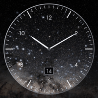

+++
title = "Projects"
slug = "projects"
+++

## Ascuta





Ascuta is a private, on-device voice-to-text app for Android. A floating mic bubble dictates into any app using open-source speech models that run fully offline, with optional AI post-processing and cloud transcription using your own key.
- [Ascuta website](https://ascuta.viglianisi.eu)
- [Ascuta on Google Play](https://play.google.com/store/apps/details?id=eu.viglianisi.ascuta)

## Oinkoin





Oinkoin is a cross-platform personal finance and expense-tracking application built with Flutter. Manage your personal finances easily and securely with just few taps. It is an offline and ad-free app. (390+ stars, ~1400 monthly active users)
- [Oinkoin website](https://oinkoin.com)
- [Oinkoin on Google Play](https://play.google.com/store/apps/details?id=com.github.emavgl.piggybank&hl=en&gl=US)
- [Github](https://github.com/emavgl/oinkoin)

## richtigelage.at





Built a web app that computes livability score for residential locations based on aggregated results from diverse open-data catalogs and OpenStreetMap. Developed a backend analytics pipeline to aggregate user requests, enabling real-time insights into trending search zones and top-rated locations.
- [richtigelage.at](https://richtigelage.at)

## JustBooth





Turn any Android tablet or phone into a standalone photobooth — no extra hardware, no complicated setup. Works with the built-in camera or Olympus cameras via Wi-Fi. Features many configuration options, among which: kiosk mode, support for any printing app, branding, and more.
- [JustBooth website](https://justbooth.viglianisi.eu)
- [JustBooth on Google Play](https://play.google.com/store/apps/details?id=eu.viglianisi.photobooth)
- [Blog post](/posts/photo-booth-for-wedding/)

## KAOS





KAOS is a fast arcade survival game for Android. Tilt your phone to roll the ball, dodge crumbling walls and falling meteors, and survive the rising chaos for as long as you can. Features tilt controls, weekly and all-time leaderboards, shareable runs, and offline play.
- [KAOS website](https://kaos.viglianisi.eu)
- [KAOS on Google Play](https://play.google.com/store/apps/details?id=eu.viglianisi.kaos)

## SWISH





SWISH is a one-thumb arcade basketball game for Android. Flick the ball into the hoop, chain baskets to build a combo, and bounce shots off the walls for extra points. Every basket adds time back to the sixty-second clock, and there is no last level. Free, no ads, and it works offline.
- [SWISH website](https://swish.viglianisi.eu)
- [SWISH on Google Play](https://play.google.com/store/apps/details?id=eu.viglianisi.swish)

## Galassia





Galassia is a minimal analog watch face for Wear OS. A real Milky Way panorama sits behind the dial and rotates through 32 tiles of the night sky, changing every 30 minutes. Features a vintage-inspired dial, a date complication, an optional center text complication, three tick styles, and it is designed for round AMOLED watches.
- [Galassia website](https://viglianisi.eu/astro-watchface/)
- [Galassia on Google Play](https://play.google.com/store/apps/details?id=eu.viglianisi.galassia)
